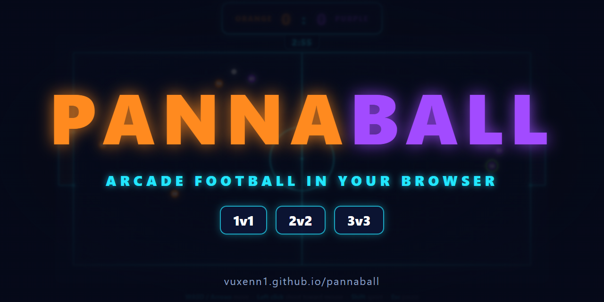
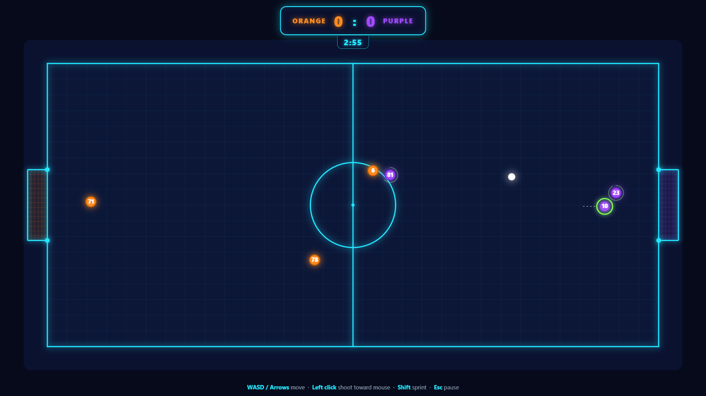
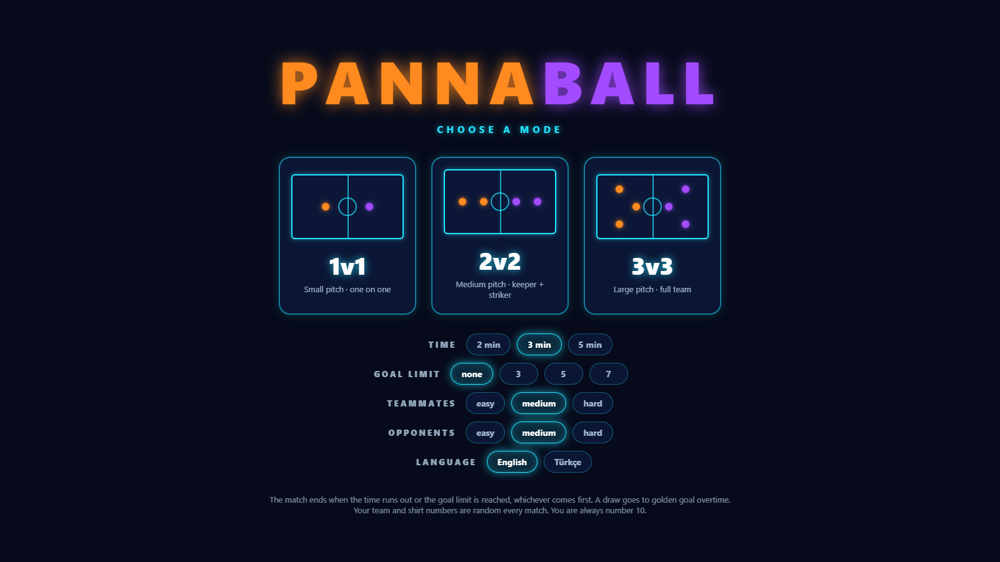

**A fast, top-down arcade football game that runs in the browser.** 
Play 1v1, 2v2 or 3v3 against bots, with your own bot teammates.

## Screenshots

## Features

- Three modes: 1v1, 2v2 and 3v3, each with its own pitch size
- Bot teammates and opponents with easy, medium and hard difficulty
- Bots take roles (chaser, keeper, support), pass, and pick open corners when shooting
- Match length of 2, 3 or 5 minutes, with an optional goal limit
- Golden goal overtime when the match ends in a draw
- Sprint with a stamina bar
- Match stats at full time: scorers, shots and possession
- English and Turkish language options

## Controls

| Key | Action |
| --- | --- |
| WASD / Arrow keys | Move |
| Left click | Shoot toward the mouse |
| Shift | Sprint |
| Esc | Pause |
| 1 / 2 / 3 | Start a mode from the menu |
| Enter | Play again after a match |

## Run locally

No build step or install needed. Download the project and open `index.html` in a browser.

## Built with

Plain HTML, CSS and JavaScript, drawn on a canvas. No libraries.

## License

[MIT](LICENSE)
